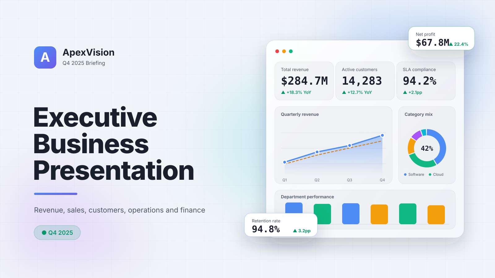

# Executive Business Presentation — Interactive Enterprise Dashboard

**Q4 2025 Briefing**  
A world‑class, production‑ready HTML5 dashboard that combines storytelling, live analytics, and interactive data visualizations into a single‑file executive briefing. Built for decision‑makers who expect precision, performance, and elegance.



---

## 🚀 Overview

This project delivers a fully interactive presentation experience — not a traditional slide deck. It simulates a premium SaaS executive dashboard with animated KPI cards, interactive charts, live filtering, keyboard navigation, dark/light themes, RTL bilingual support (Arabic/English), and full‑screen presentation mode. Every element is designed to the standards of Fortune 500 executive reporting.

## ✨ Key Features

- **9 Interactive Sections** — Executive Summary, Business Overview, Revenue Dashboard, Sales Performance, Customer Analytics, Operations, Financial Overview, Strategic Insights, Decision & Action Plan.
- **Animated KPI Counters** — Smooth count‑up animations for revenue, customers, SLA, and profit data.
- **Live Charts** — Line, bar, doughnut, and funnel visualizations powered by Chart.js.
- **Dynamic Filters** — Toggle between monthly/quarterly/yearly revenue views and filter sales by region in real time.
- **Progress Bars & Risk Indicators** — Visualize operational KPIs, financial risks, and performance metrics.
- **Enterprise‑Grade UI** — Glassmorphism cards, subtle animations, ambient glows, and responsive layout.
- **Bilingual RTL Support** — Switch the entire interface to Arabic (العربية) with a single click; all text, chart labels, and layout adapt correctly.
- **Presentation Toolkit** — Fullscreen mode (F), dark/light theme (D), export/print (E), and keyboard shortcuts.
- **Performance Optimized** — 60 FPS rendering, GPU‑accelerated animations, lazy chart loading.
- **Zero Dependencies Beyond Chart.js** — Pure vanilla JavaScript, embedded CSS, no frameworks.

## 🛠 Technology Stack

| Technology | Role |
|------------|------|
| HTML5 | Semantic structure, accessibility‑ready |
| CSS3 | Glassmorphism, custom properties, RTL layouts, animations |
| JavaScript (ES6+) | State management, keyboard navigation, i18n, Chart.js integration |
| Chart.js | Interactive, responsive charts with live filtering |
| SVG | Cover art and scalable vector elements |

## 📦 Usage

1. **Clone or download** the repository.
2. Open `index.html` in any modern browser (Chrome, Edge, Firefox, Safari).
3. No build tools, no local server required — everything runs offline.

### Keyboard Shortcuts

| Key | Action |
|-----|--------|
| `←` `→` or `↑` `↓` | Navigate between slides |
| `1` … `9` | Jump directly to a slide |
| `F` | Toggle fullscreen presentation mode |
| `D` | Toggle dark/light theme |
| `E` | Export / print the presentation |
| `Esc` | Exit fullscreen |

### Language Toggle

Click the **🌐 اللغة** button in the sidebar to switch between **English** and **العربية (Arabic)**. The entire interface, including chart labels and dynamic texts, translates instantly, and the layout flips to right‑to‑left (RTL) appropriately.

## 📂 File Structure

```

├── index.html                       # Main interactive presentation
├── executive-enterprise-dashboard-cover.svg   # Project cover image
└── README.md

```

## 🎯 Design Philosophy

- **Data‑First** — Every visualization answers a business question.
- **Executive Readiness** — Suitable for boardroom, stakeholder demos, or portfolio showcases.
- **Minimal, but Powerful** — No visual clutter; every pixel serves a purpose.
- **Accessible & Inclusive** — Bilingual support, keyboard navigation, and responsive design.

## 🌍 RTL / Arabic Support

The presentation includes a full Arabic translation with properly rendered HTML, bidirectional text, and reversed layout for cards, tables, and progress indicators. It respects cultural UX expectations while maintaining the same premium feel.

## 🧩 Customization

You can easily tailor the presentation to your own data:

- Modify the `translations` object in the `<script>` for different languages or phrasing.
- Update chart data arrays (revenue, sales, KPIs) inside `createAllCharts()`.
- Adjust the color palette by editing CSS custom properties in `:root`.

## 🖨 Export & Print

Press `E` or click the **Export / Print** button to open a print‑optimized view. All slides render as pages, hiding the sidebar and background effects for a clean document.

## 👤 Credits

**Development & Design**  
Amr AL-Mukardi — Full‑Stack Web Developer

---

## 📄 License

free for personal and commercial use. Attribution is appreciated but not required.

*Crafted with precision by an enterprise presentation architect — blending technology, design, and strategy.*
